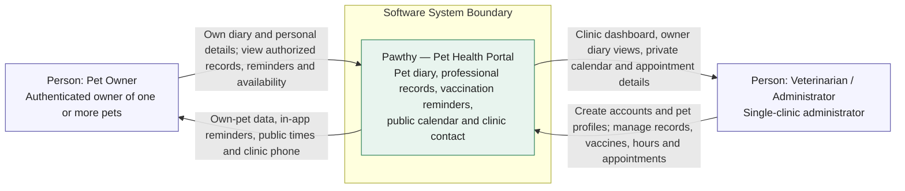
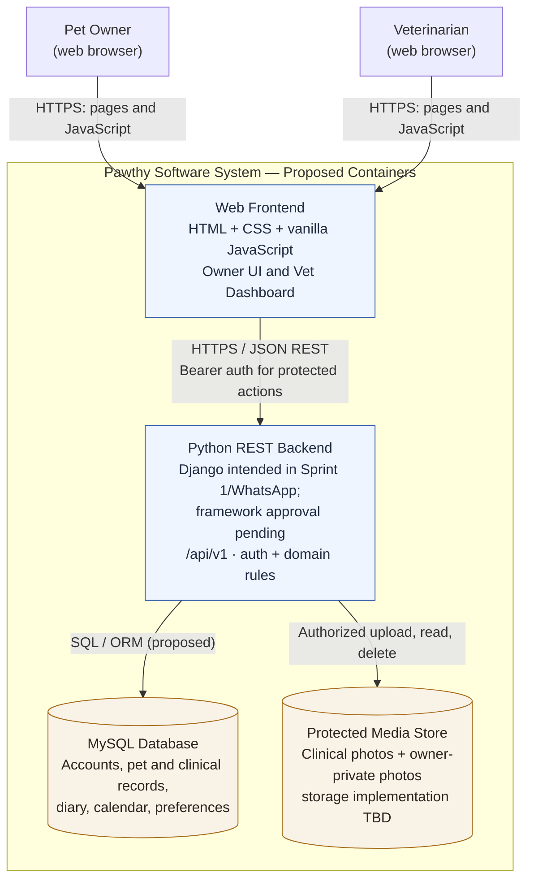
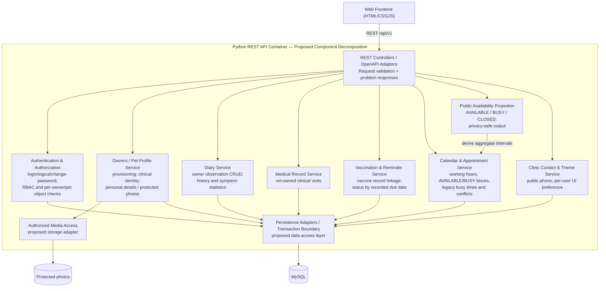

# Pawthy — C4 Software Architecture (Sprint 2)

> **Document owner:** Software Architect (Efe) · **Date:** 2026-11-19 · **Status:** PROPOSED / design review draft · **Contract:** OpenAPI 3.1.0, `info.version: 0.6.3`  
> **GitHub source baseline:** `HUARGE/Pawthy`, `develop` at `a5c08a8534c8e6512f6621628bf751b434977d83`. This document describes intended architecture, **not an already implemented or deployed application**.

## 1. Purpose, scope and evidence

This document explains **what Pawthy is**, **which deployable/application-level units it needs**, and **how the REST API can be decomposed into responsible components**. It is restricted to the software architect's Sprint 2 deliverable; it does not implement the frontend, backend, QA tests, SRS, deployment or release.

| Source | Why it is used | Status |
|---|---|---|
| `docs/sprint-reports/Pawthy_Sprint1_Team10-1.md` | Approved working scope, six epics, **13 user stories** US-01–US-13, actors and business rules | Sprint 1 working draft v0.5, not a separate approved Sprint 2 SRS |
| `api/openapi.yaml` | Operations, roles, paths, payload schemas and response behavior | Proposed OpenAPI contract **v0.6.3**; not executable API |
| `docs/architecture/system-context-diagram.png` | Existing Sprint 1 context illustration | Source context, not mechanically copied |
| `docs/devops/ci-cd-plan.md` | Future hosting assumptions | Sprint 3 plan; Django **or** FastAPI still needs an architecture decision |
| WhatsApp messages / `sprint 2 planlamasi.txt` | Ownership, date and team decisions | Efe owns C4 and UML; frontend **HTML/CSS/JavaScript**, not React; work reviewed 22–23 Nov |
| Uploaded Sprint 2 NFR, quality and test files | Security, privacy, reliability, performance design checks | 15 NFRs, 24 **unexecuted** test scenarios; managed by QA, referenced only |

**Source priority for architectural modeling:** current `develop` OpenAPI + Sprint 1 final-working scope + explicit later team decisions. Mark implementation choices not yet settled as *Proposed*. Do not use the uploaded older v0.2.0 contract or the repository's historical `pawthy_openapi_v0.3.0.yaml` for current appointment flow.

### 1.1 Product boundary and invariants

- **One clinic; one veterinarian/administrator; multiple pet owners.** Only two authenticated roles: `VETERINARIAN` and `PET_OWNER`. `PUBLIC` in OpenAPI means anonymous/public access, **not a third account role**.
- The veterinarian provisions owner accounts and pet profiles; professional records, vaccination histories, availability blocks, weekly schedule and manually agreed appointments are veterinarian-controlled.
- Owners can create/edit/delete *their own* health-diary entries and private notes/photos, and view their own medical/vaccination information; veterinarian reads owner diary data but does not modify it.
- Owner-visible `GET /availability/calendar` is **read-only and privacy-safe**: time/status (`AVAILABLE`, `BUSY`, `CLOSED`) and clinic phone only; it must not expose appointment details, other owners or their pets.
- Appointments are arranged **by phone or in person**, entered in Pawthy **only by the veterinarian**, with `CONFIRMED` or `CANCELLED` status. No online requests, approval queue, `PENDING_APPROVAL`, `REJECTED`, auto-generated booking slots or automatic appointment email/SMS.
- Vaccination reminders are **website-only**, based on the veterinarian-entered `next_due_date`. No diagnosis or automated vaccination schedule recommendation.
- Timestamp handling for appointment/calendar operations uses **Europe/Istanbul** and ISO 8601 offsets.

## 2. C4 Level 1 — System Context

**Question answered:** Who interacts with Pawthy, and for what purpose? At Level 1, database, web server and API are **inside the single Pawthy system** and intentionally not shown.

**External manual workflow:** Owner and veterinarian may contact each other by **telephone or face to face** to arrange a visit. This interaction happens **outside** Pawthy, even though Pawthy displays the clinic phone and the veterinarian subsequently records the appointment. No call center, telephony API or SMS/email provider is modeled.

**Trace:** US-01–US-13; `GET /clinic/contact`; `GET /availability/calendar`; `POST /appointments` veterinarian-only. This level refines the Sprint 1 context illustration without introducing a new software actor.

## 3. C4 Level 2 — Container View

**Question answered:** What are the major application and data containers, and which protocols connect them? C4 “container” means a separately running/hosted application or data store, **not necessarily Docker**.

### 3.1 Container responsibilities

| Container | Primary responsibility | Data/security boundary | Grounding |
|---|---|---|---|
| Web Frontend | Static UI for owner and vet, calendars, medical/diary forms, reminders, saved theme | Client-side hiding **does not** replace backend authorization | Sprint 1 selected HTML/CSS/JS; WhatsApp confirms React dropped |
| Python REST Backend | `/api/v1` operations, schema validation, role and owner/pet authorization, scheduling conflicts, reminder computation, public projection | Trust boundary: enforces `401`, `403`, private-object `404`; never exposes vet-only data on public calendar | OpenAPI v0.6.3 |
| MySQL | Durable account, pet, diary, medical, vaccination, appointment and availability records | Database access limited to backend; atomic write boundaries to be designed | Sprint 1 feasibility stack (proposed) |
| Protected Media Store | Personal gallery and veterinarian clinical identification photos | Verify ownership/role before upload, access and deletion; public URLs must not bypass privacy | Photo endpoints; NFR-15 |

**Deployment note (not implementation evidence):** `docs/devops/ci-cd-plan.md` proposes Nginx serving static files, a Python backend, Docker/Compose and VPS/GHCR. These are **future deployment choices**, not a mandatory part of the current logical container model. Its wording leaves *Django vs FastAPI* open; the team chat favors Django. We represent the backend as **Python REST API, final framework to confirm**, not as finished Django code.

### 3.2 Data movement and trust boundaries

1. The browser loads static frontend assets and interacts with the API. Login is public (`POST /auth/login`); protected endpoints require bearer authorization, per-operation `x-roles` and resource ownership checks.
2. Owner private data flows only through authorized endpoints. Never return a raw veterinarian appointment entity through public `/availability/calendar`; construct separate `AvailabilityInterval` responses.
3. The backend reads and writes the database; data persistence, concurrent appointment conflict checks and session invalidation are backend concerns, **not frontend promises**.
4. Media access must respect the difference between veterinary clinical photo (`PUT /pets/{petId}/clinical-photo`) and owner-only photo collection (`/pets/{petId}/photos`). Storage/CDN design remains unchosen.
5. No third-party integrations are required (payment, external SMS/email, Google Calendar, national registry, AI diagnosis and emergency dispatch are out of scope).

## 4. C4 Level 3 — Backend Component View

**Question answered:** How can the *Python REST Backend container* be decomposed into modules corresponding to the current contract? **These are proposed logical components, not existing Django apps or source folders.**

> Every protected request must pass the auth layer **before** any private data is returned or changed. The arrows above are logical responsibilities, not a complete call graph or evidence that the services already exist. A controller may call more than one domain service.

### 4.1 Component → API mapping

| Component | Contract endpoints (representative, exact current paths) | Core responsibility |
|---|---|---|
| Auth & Access | `/auth/login`, `/auth/logout`, `/auth/change-password` | Token lifecycle and role guards; owner/pet scope applies across all protected routes |
| Owner and Pet | `/pet-owners`, `/pet-owners/{ownerId}`, `/pet-owners/{ownerId}/temporary-password`, `/pet-owners/{ownerId}/pets`, `/pets`, `/pets/{petId}`, `/pets/{petId}/personal-details`, `/pets/{petId}/archive`, `/pets/{petId}/photos`, `/pets/{petId}/clinical-photo` | Vet creates/edits clinic identity; owner-only personal notes/photos; pet archiving and clinic status |
| Diary | `/symptoms`, `/pets/{petId}/observations`, `/pets/{petId}/observations/{observationId}`, `/pets/{petId}/observation-statistics` | Voluntary timestamped owner diary; vet read-only; missing dates not treated as healthy |
| Medical | `/pets/{petId}/medical-records`, `/pets/{petId}/medical-records/{recordId}` | Veterinarian creates/edits professional clinical data; authorized owners read |
| Vaccination | `/species/{speciesCode}/vaccines`, `/pets/{petId}/vaccinations`, `/pets/{petId}/vaccinations/{vaccinationId}`, `/vaccination-reminders` | Vet vaccine records; 7-day / due / overdue reminder states; linkage completion |
| Appointment & Calendar | `/veterinarian/schedule`, `/busy-times`, `/availability/blocks`, `/appointments`, `/appointments/{appointmentId}`, `/veterinarian/calendar` | Vet-only schedule changes, interval conflict validation, manual appointment history and details |
| Public Calendar | **`GET /availability/calendar`** | Public time-only projection; no raw appointment/owner/pet data |
| Contact & UI Preference | `/clinic/contact`, `/me/theme` | Public clinic phone; vet update; authenticated per-user theme |

### 4.2 Important boundary cases (review checklist)

- **Owner privacy:** A veterinarian sees clinic/clinical data but **must not** see owner-private personal notes or photo galleries. Owner A cannot access Owner B's pets, observations, records or appointments; inaccessible cross-owner private resources are modeled as `404`, not silently shared data.
- **Calendar precedence:** Weekly working hours give the baseline; explicit AVAILABLE periods can open otherwise closed periods; explicit BUSY blocks, legacy busy-time exceptions and active appointments make time BUSY; fully unavailable outside hours is CLOSED unless explicitly opened. The contract rejects overlapping explicit availability blocks with `409`. The exact interaction of `/busy-times` with `/availability/blocks` requires a team architecture decision.
- **Appointment transaction:** Every create/reschedule validates `ends_at > starts_at`, minimum **10 minutes**, required pets belonging to the chosen owner, clinic hours, blocked time and overlap with other active appointments. Use a transaction/concurrency safeguard (specific DB technique to be confirmed) so two simultaneous writes cannot both confirm the same interval.
- **Cancellation:** `CANCELLED` remains in history but stops occupying the calendar. Owner cannot create or modify appointments; veterinarian changes them in the clinic dashboard after offline contact.
- **Reminders:** Vet records next due date. Upcoming reminders start **7 days before** due date, then `DUE_TODAY`, then `OVERDUE`; linkage with a later vaccination may mark previous reminder `COMPLETED`; deceased pet or cleared due date leads to `DISCONTINUED`. Default endpoint returns active states. No push, email or SMS.
- **Time correctness:** All appointment and availability instants use offset-aware ISO 8601; UI must keep the Europe/Istanbul clinic context and avoid accidental conversion to a different clinic day.
- **Uploads:** Owner and clinical photo permissions are distinct. JPEG/PNG, max 5 MiB is an **NFR-15 acceptance policy**, **not** a numeric OpenAPI v0.6.3 schema guarantee; do not claim it is implemented.
- **Response standards:** Implement `items/next_cursor` listing shapes and `application/problem+json` validation error responses where specified in OpenAPI. Do not conflate 401 unauthenticated, 403 wrong role and 404 other-owner object.

## 5. Explicit decisions versus open architectural questions

| Topic | Baseline decision | Still needs confirmation / reviewer |
|---|---|---|
| Frontend | **HTML, CSS, vanilla JavaScript**; no React | None for Sprint 2 logical architecture; frontend team owns exact pages and styles |
| Backend framework | Python; Django described in Sprint 1 and team messages | `docs/devops/ci-cd-plan.md` still says **Django or FastAPI**; formal ADR/team confirmation needed |
| Database | MySQL proposed in Sprint 1 | Schema, migrations, transactional conflict strategy TBD by implementation team |
| File storage | Protected photos must be role/owner restricted | Storage mechanism, signed-URL/public URL policy TBD |
| Public calendar | AVAILABLE/BUSY/CLOSED time intervals only | Deterministic precedence when `busy-times` and explicit blocks interact; document edge fixtures |
| Realized SRS conformance | Sprint 1 report and API traced | Deniz's **Sprint 2 standalone SRS** not in `develop` at baseline, so final SRS conformity is **Pending Review**, not “Pass” |
| Performance and uptime | Sprint 2 NFR acceptance targets defined by QA | No deployment/benchmarks; no test claimed executed |

## 6. Architecture review acceptance criteria

- [x] Level 1 contains the two actors and one system boundary; manual phone contact remains outside the software.
- [x] Level 2 separates browser-facing static UI, REST API, MySQL and protected media with explicit trust boundaries.
- [x] Level 3 components map to all major OpenAPI groups, including the distinct **public calendar projection** and both availability block APIs.
- [x] No React, online owner booking, approval queue, external SMS/email or automated diagnosis appears as a requirement.
- [ ] Formal backend/framework ADR and calendar precedence are approved by the implementation team.
- [ ] Deniz's final SRS is checked against the model; changes recorded in the architecture alignment report.
- [ ] Peer review / GitHub Issue + PR evidence is recorded after team review.

**Related artifacts:** [`../uml-diagrams/uml-diagrams.md`](../uml-diagrams/uml-diagrams.md) · [`api-srs-alignment.md`](api-srs-alignment.md).  
**Repository hygiene:** This document contains **no WhatsApp screenshots or private contact details**; only distilled technical decisions are included.
