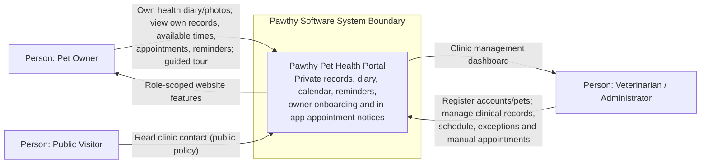
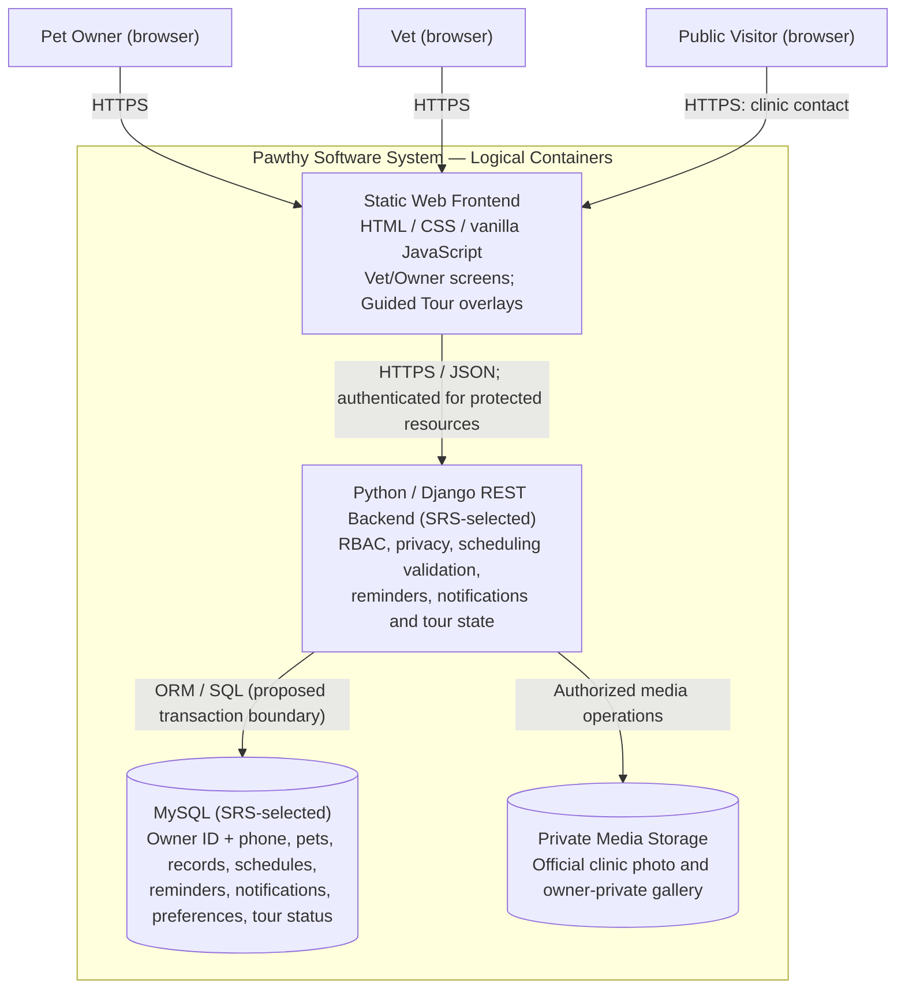
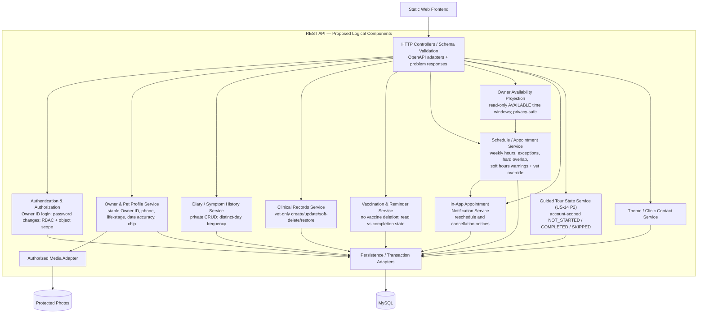

# Pawthy — C4 Architecture (Sprint 2, 20 November SRS Reconciliation)

> **Owner:** Efe, Software Architect · **Status:** DESIGN PROPOSAL / peer review required · **Date:** 20 November 2026.  
> **Functional source:** Deniz's 69-page Pawthy Functional Requirements SRS **and the five-page Section 5.2 Software Interfaces supplement** shared on 20 November 2026. The 69-page PDF **still duplicates §3.7 and omits §3.8**, but a separate team screenshot now supplies **FR-08 — View Veterinary Clinical Records (Must Have)** with seven requirements and eight acceptance criteria.  
> **Current published API:** `api/openapi.yaml` v0.6.3 in `HUARGE/Pawthy:develop`. It predates the SRS; design changes below are **not proof of API/implementation changes**. See [alignment](api-srs-alignment.md) and [SRS review](srs-2026-11-20-review.md).

## 1. System context and confirmed scope

One veterinary clinic, one authenticated veterinarian/administrator, and multiple authenticated pet owners. A public visitor may access the clinic's public contact information, but the **SRS explicitly grants weekly availability viewing to authenticated owners**; existing v0.6.3 public-calendar exposure requires a policy decision before API modification. There are **two authenticated roles**, not three.

- **Veterinarian:** provision owner accounts with required name and phone, create pet profiles, manage clinical and vaccination data, working schedule, calendar exceptions and manually arranged appointments.
- **Pet Owner:** first-login password replacement using stable Owner ID, read own **non-soft-deleted** clinical records newest-first, including all populated vet fields (without editing), plus official pet/vaccination data, manage own photo gallery and health diary, view only available clinic times, view own appointments and in-app notifications, choose theme and optionally follow a guided tour.
- **External manual contact:** owners contact the clinic via phone/in person to arrange appointments. No online owner booking, payment, SMS/email, external calendar synchronization, automated diagnoses or AI triage.
- **US-14 guided tour** is P2 / Should Have, not required for the initial Sprint 3 MVP. It is an owner-only UI teaching flow, not a clinical service.

### C4 Level 1 — System Context

**Trust interpretation:** Level 1 shows the **entire system** as one software box. The phone call itself is outside Pawthy; neither telephone nor a third-party messaging service is a C4 software dependency.

## 2. C4 Level 2 — Container View

| Container | Responsibilities | Critical safeguards | Evidence / status |
|---|---|---|---|
| Web frontend | Read-only owner availability, veterinarian calendar, health screens, theme, US-14 contextual overlays with Next/Back/Skip and Help replay | UI cannot grant permissions, bypass profile restrictions or treat tutorial replay as account reset | HTML/CSS/JS in team scope; detailed screens implementation-owned |
| Python REST backend | Owner ID authentication, mandatory password change, role-and-object authorization, calendar calculations, appointment hard conflicts and warnings, diary/vaccine/reminder services, tour persistence, owner notifications | Server-side checks on **every** read and mutation; never expose other owners' records | **Django is selected by the latest SRS (Software Interfaces 5.2.2)**; implementation decisions still require technical review |
| MySQL | Stable account IDs separate from mutable phone, birth date accuracy, life stage and chip state, visit/vaccine records, owner diary, schedule and appointment history, notification and onboarding flags | Foreign keys, data integrity, atomic double-booking prevention; exact schema/migrations still unimplemented | SRS-selected relational database; physical tables are still proposed |
| Protected media store | Vet-managed clinic photo, owner-managed personal gallery | Vet is **not** authorized to browse owner's private gallery; URLs must not bypass access checks | Storage technology not finalized |

## 3. C4 Level 3 — Backend Component View

**Logical-only modules:** These are decompositions of a **future** backend, not existing Python/Django files, deployed processes or confirmed SQL tables. In particular `GuidedTourState` and `AppointmentNotification` are **new SRS requirements not specified** in OpenAPI v0.6.3.

### 3.1 Component ↔ current API ↔ SRS coverage

| Component | Existing v0.6.3 operation / schema | SRS changes needed |
|---|---|---|
| Auth / Owner | `POST /auth/login`, `POST /auth/change-password`, `POST /pet-owners`; `LoginRequest`, `OwnerAccountRequest` | **FR-01.2/01.3/01.9, FR-02.3**: required phone + full name, stable Owner ID distinct from phone, login by ID (current API expects email), phone edit endpoint |
| Pet Profiles | `/pets`, `/pets/{petId}`, personal and clinical photo routes | **FR-04.9–04.22**: vet-only life stage, exact/estimated birth date, mandatory chip status/conditional chip number; preserve clinic/gallery separation |
| Diary & History | `/pets/{petId}/observations`, `/observation-statistics` | Distinct `created_at` vs `observed_at`; diary statistics count distinct reported calendar days; missing entries never imply health |
| Clinical | `GET /pets/{petId}/medical-records` (already supports owner read, most-recent-first); record `POST/PATCH` vet-only | **US-07**: vet-authorized soft deletion and restoration preserving vaccine/diary records. **FR-08 Must Have**: own-pet read-only records newest-first; display all populated clinical/vet-note fields; omit blank optional fields; hide soft-deleted records until vet restoration; render informative empty state; block other-owner access. Current API lacks explicit delete/restore and deleted-record filtering policy. |
| Vaccination & Reminders | `/pets/{petId}/vaccinations`, `/vaccination-reminders` | SRS `Scheduled/Upcoming/Due/Overdue/Completed/Suppressed`, independent read flag and owner mark-read; vet monitoring includes archived pets; no vaccination delete |
| Scheduling | `/veterinarian/schedule`, `/availability/blocks`, `/busy-times`, `/appointments` | Hard block overlapping active appointments; **warning + explicit vet override** only for out-of-hours/unavailable time; status Scheduled/Completed/Canceled, time and update notification |
| Availability Projection | `GET /availability/calendar` public current | **FR-11.10/11.11:** authenticated owner, weekly **available-only**; public-vs-owner decision needed |
| Guided Tour | **No endpoint** | **FR-14.01–14.16**: owner-account state, four steps, skip/finish persistence, Help replay preserving prior status |
| Theme / Contact | `/me/theme`, `/clinic/contact` | Retain independent user-specific light/dark theme; clinic phone shown alongside owner availability |

### 3.2 Priority security / consistency paths

1. **Source technology and boundaries (SI-01–SI-07):** The new SRS selects HTML/CSS/JavaScript, Python/Django, MySQL, and OpenAPI/YAML; browser clients never access MySQL directly. Django validates requests, enforces authorization, and protects referential integrity. Clinical record deletion is **soft** and restoration is supported. No external integration is required.
2. **Registration & first login:** A system-generated **Owner ID is not a phone number**, remains stable across phone edits, and is the login name under the SRS. Store password hashes; present the initial temporary password once to vet for in-person delivery. Prevent access to protected features until first password change is complete.
2. **Pet identity:** Birth date is recorded as **Exact or Estimated**; life stage is chosen by vet, not algorithmically derived from universal age cutoffs. Only vet edits official identity/clinic photo; owner private gallery is not shared with vet. When status is deceased, clinical history remains, active/future vaccination reminders suppressed.
3. **Diary privacy:** Owner-only mutations, vet read-only; no synthetic observation on missing days. Observation timestamp separate from creation timestamp. A selected symptom on one calendar day counts once in frequency, even if repeated in entries.
4. **Appointment integrity:** Each appointment belongs to exactly one owner and one-or-more pets belonging to that owner; minimum duration **10 minutes**. Reject active collisions even on an override. For out-of-hours/unavailable periods, return a warning that requires vet's **explicit consent**, then repeat the conflict check **atomically** before saving; cancellation releases occupancy and keeps history. Reschedule/cancel generates **in-app** owner notice. The exact warning wire protocol is an **API design question**.
5. **Calendar read projection:** Vet sees Available/Unavailable/Occupied. Owners should see **available-only** weekly intervals with clinic telephone, no other owners, pet IDs, clinical notes, or booking controls. The existing API's `security: []` and busy/closed periods **do not match** and must not be silently represented as compliant.
6. **Reminder lifecycle:** SRS distinguishes Scheduled (more than 7d, hidden from owner's active dashboard), Upcoming (1–7d), Due, Overdue, Completed and Suppressed. Owner's independent read flag never completes vaccine. Linked new dose marks previous reminder completed; archived pet's active reminders hidden from owner but visible to vet, deceased suppresses both.
7. **Guided tour:** Only after mandatory initial password change and initial dashboard visit; four **My Pets → Health Diary → Health Records → Vaccinations & Reminders** steps, translucent dim/tooltip, Next/Back/Skip; account-level Completed/Skipped survives device changes. Replay from Help leaves original persisted status untouched and never blocks app use.
8. **No unjustified API promises:** A model cannot declare HTTP status, database locks, endpoint names, data type, public policy or deployed logic where the current OpenAPI and SRS do not agree. See the [explicit API change proposal](../../api/srs-sync-proposal-2026-11-20.md).

## 4. Decisions and outstanding review items

| Ref | Decision / evidence | State / responsible owner |
|---|---|---|
| D-01 | Frontend HTML/CSS/vanilla JavaScript; no React | Team scope; UI owner decides layout |
| D-02 | Python / Django REST API and MySQL selected in supplementary SRS §5.2.2 | **Selected in new SRS**; implementation ADR should reconcile older DevOps text |
| D-03 | MySQL and restricted photo store | Proposed; backend/security owner specifies physical data design |
| D-04 | Owner-ID login and phone requirement vs API email requirement | **Open — high**, API owner + Deniz |
| D-05 | Vet override with active overlap prohibition; availability block precedence `/busy-times` vs `/availability/blocks` | **Open — high**, API/backend owner |
| D-06 | SRS available-only authenticated owner calendar vs public busy/closed API | **Open — high**, Product Owner + security/API owner |
| D-07 | Reminder status and read model; appointment completion/notification wire representation | **Open — high**, API owner |
| D-08 | US-14 API and account persistence, P2; initial MVP exclusion | API proposal pending, Product Owner to prioritize |
| D-09 | 69-page SRS duplicates §3.7 and omits §3.8; **separate FR-08 screenshot now supplied** | **FR-08 requirement content verified**; PO should replace duplicate §3.7 with FR-08 in canonical PDF (editorial, no invented requirements) |
| D-10 | Concurrent writes and token/session revocation strategy | Design review, not implemented or performance tested |

## 5. Architectural acceptance criteria (design review only)

- [x] New SRS, the software interfaces supplement and separately supplied **FR-08 Must Have** screenshots inspected; the canonical PDF's duplicated §3.7 still requires an editorial correction.
- [x] C4 L1 / L2 / L3 include optional guided tour and in-app appointment notifications.
- [x] Server-side owner scope and private-photo isolation maintained.
- [x] Vet warning override correctly differs from non-overridable active appointment overlaps.
- [x] Owner account ID, phone and pet data accuracy target state represented.
- [x] Strictly distinguish **target SRS** and **existing v0.6.3 API**, do not claim tests passing.
- [ ] Team/PO resolves source ambiguities and approves versioned API contract changes.
- [ ] SRS stack selection acknowledged; physical schema, data retention and security scheme approved.
- [ ] GitHub PR peer review and merge confirmed.

**Companion documentation:** [UML diagrams](../uml-diagrams/uml-diagrams.md) · [SRS delta review](srs-2026-11-20-review.md) · [API alignment](api-srs-alignment.md).  
