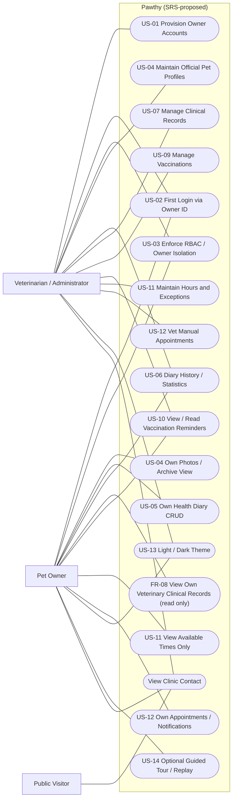
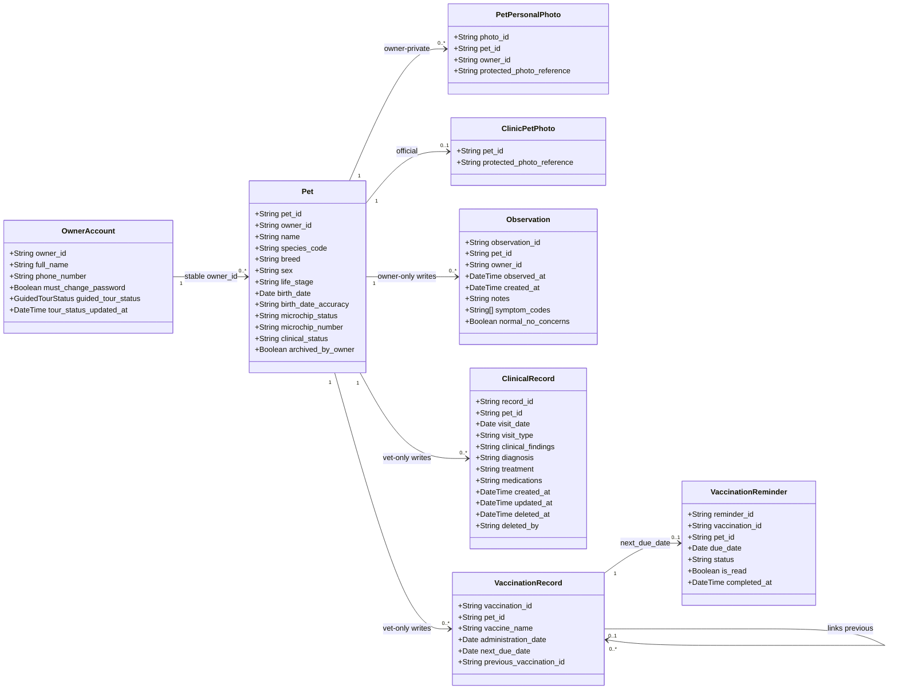
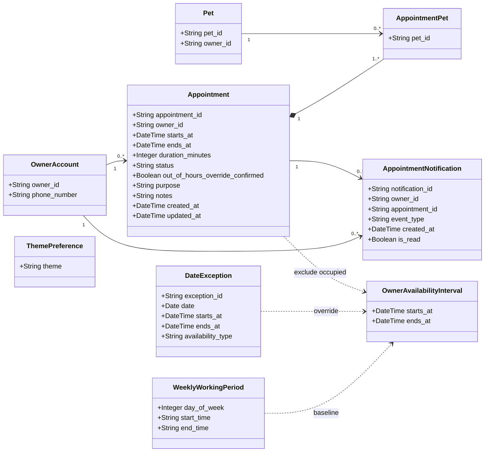
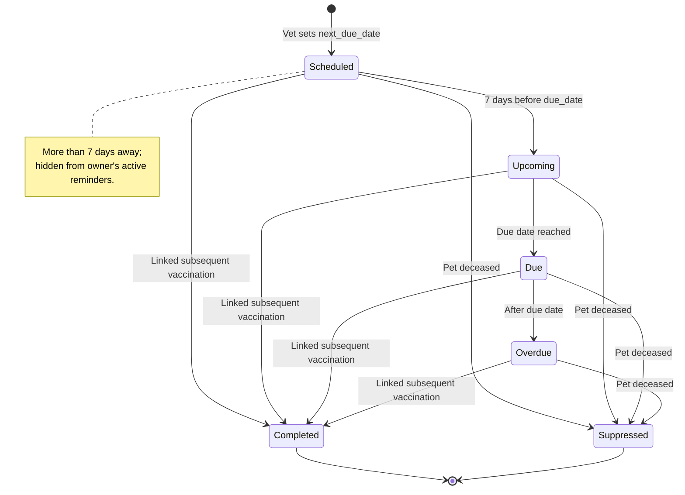

# Pawthy — UML Design Diagrams (Sprint 2 SRS Reconciliation)

> **Owner:** Software Architect (Efe) · **Reviewed:** 20 November 2026 · **Status:** PROPOSED DESIGN, not implemented or formally approved.  
> **Source of proposed behaviors:** Deniz's 69-page *Functional Requirements* SRS supplied 20 Nov 2026 (sections 3.1–3.14). **Contract actually published:** `api/openapi.yaml` v0.6.3 on `develop`.  
> **Important:** The 69-page SRS repeats section 3.7 (US-07) and has no separate US-08 section. The supplementary **5.2 Software Interfaces** requires Django/MySQL, backend-only database access, **soft deletion and restoration**. **FR-08 View Veterinary Clinical Records** has since been supplied in separate team slides (screenshots starting on slide 31/222, **Must Have**). Owner-only read requirements are now grounded. The 69-page PDF still needs its duplicate section edited and 3.8 inserted. See [SRS review](../architecture/srs-2026-11-20-review.md).

## 1. Diagram index and model status

| Model | Coverage | Review status |
|---|---|---|
| Formal PlantUML | [use-cases.puml](use-cases.puml) | Updated for US-14, owner-only actions and SRS conflicts |
| Use-case overview | US-01–US-14 including now-confirmed owner-only **FR-08** | Proposed design; SRS PDF still needs editorial repair |
| Class A | Owner, Pet, diary, clinical, vaccination, reminder, guided-tour state | Target fields; differences from API 0.6.3 below |
| Class B | Working calendar, manual appointment, in-app notification, theme | Target fields/statuses; contract changes pending |
| Sequence 1 | Initial Owner ID login and password change | Account identifier mismatch pending API owner |
| Sequence 2 | Manual appointment: overlap rejection vs out-of-hours override | API extension pending |
| Sequence 3 | Vaccination record, reminders, read status | API model extension pending |
| Sequence 4 | Owner weekly availability | Public-vs-owner response mismatch pending |
| Sequence 5 | Optional four-step US-14 guided tour | New API contract needed, P2 |
| Sequence 6 | **FR-08 View Veterinary Clinical Records:** owner authorization, newest first, no soft-deleted data, empty-state | API GET exists; deleted-record filtering/UI behavior not yet guaranteed |
| State machines | Appointment / Vaccination reminder / Guided tour | SRS-target states; not API v0.6.3 enums |

*Notation:* Mermaid diagrams represent **SRS-target logical design**, not already implemented database tables. The existing API fields must **not** be claimed to conform until approved and changed. Dashed arrows indicate derived views or dependency. Owner permissions must be enforced server-side.

## 2. Use Case Overview



**Actor precision:** The visitor is **not a third authenticated role**. The SRS specifically grants the **authenticated owner** weekly read-only availability, while the existing API publishes a public availability endpoint; this is an unresolved contract policy (not a claim public visitors can see owner's appointments). The veterinarian alone changes official pet/clinical/vaccination/calendar data; owner alone manages own diary and private gallery. The veterinarian can *read* owner diary, not edit it. US-14 applies to Pet Owner, never automatically to veterinarian.

## 3. Class Diagram A — Owner and Pet Health Domain (SRS target)



**FR-based constraints:**
- **FR-01.2/01.3/01.9, FR-02.3:** Full name + phone are mandatory; the generated `owner_id` remains unchanged after phone edits; initial login uses Owner ID + temporary password. Current v0.6.3 requires `email` and logs in with email — **not aligned**.
- **FR-04.9–04.12/04.19–04.22:** Vet-maintained life stage independent of exact/estimated birth date; required `microchip_status`, conditionally required number; displayed age from recorded date with an approximate marker when estimated. Current API has `estimated_age_months` and lacks explicit birth accuracy, life stage and microchip status — **gap**.
- **FR-04.13–04.17:** Vet can edit official clinic photo but not owner's private gallery; owner can manage private gallery but not vet's photo. Owner archive is **view-only**, not record deletion. Deceased pets preserve clinical history.
- **FR-05.4/05.12/05.13, FR-06.4–06.5:** `observed_at` is editable for past events, distinct from immutable `created_at`; future observation rejected; symptom frequency counts **distinct calendar days**, not repeated entries.
- **FR-07.9/07.16 + supplementary SI-07 and FR-08:** Vet may **soft-delete** clinical records after confirmation and **restore** them; they remain recoverable. Do **not cascade-delete** separately stored diary/vaccinations. `deleted_at`/`deleted_by` are proposed persistence fields, not existing API fields. SRS excludes permanent ordinary deletion of pet profile/history (US-04); Section 5.2 SI-07 confirms that clinical deletion is soft and supports restoration; final restore authorization and audit semantics require API team review.
- **FR-09.15:** Vaccination records are **not deletable by either role**; vet may update. **FR-10.11:** marking a reminder read never means vaccine completed.
- `GuidedTourStatus` is `NOT_STARTED | COMPLETED | SKIPPED` (proposed wire spelling). It belongs to the **account**, never device-local storage as the authoritative source. Tour replay retains existing state.

## 4. Class Diagram B — Scheduling, Notifications and Preferences



**Status/data precision:** The **SRS** specifies `Scheduled`, `Completed`, `Canceled` and a conditional out-of-hours override flag (US-12 table). Proposed API spelling is `SCHEDULED | COMPLETED | CANCELED` **subject to API-owner approval**; existing OpenAPI uses `CONFIRMED | CANCELLED`. A canceled appointment releases its occupied interval; an active overlapping appointment is rejected **even after** a vet overrides clinic hours. SRS FR-12.17/18 require in-app notifications for date/time changes and cancellation; there is no external SMS/email. A theme change must not touch functional records.

## 5. Sequence — Owner ID and Mandatory First-Login Password Change (US-01/02)

```mermaid
sequenceDiagram
  autonumber
  actor Vet as Veterinarian
  actor Owner as Pet Owner
  participant UI as Pawthy Browser
  participant API as Proposed REST API
  participant Auth as Auth / RBAC
  participant DB as Account Store
  Vet->>UI: Register full_name + mandatory phone_number
  UI->>API: POST /pet-owners (vet credentials)
  API->>Auth: Authorize veterinarian
  Auth->>DB: Generate stable independent owner_id + temporary password hash
  DB-->>Auth: Owner account saved
  API-->>UI: Owner ID + one-time temporary password
  Note over Vet,Owner: Vet hands password to owner in person
  Owner->>UI: Login with Owner ID + temporary password
  UI->>API: POST /auth/login
  API->>Auth: Verify account and temporary credentials
  Auth-->>API: must_change_password = true
  API-->>UI: Restricted session and mandatory change screen
  Owner->>UI: Choose valid personal password
  UI->>API: POST /auth/change-password
  API->>Auth: Validate, hash, revoke prior sessions
  Auth->>DB: Save credential, clear first_login restriction
  API-->>UI: Password changed successfully
  UI-->>Owner: Access dashboard; US-14 first-time tour eligible
```

**Contract gap:** Existing OpenAPI `LoginRequest.email` and `OwnerAccountRequest.email` contradict SRS. The wire field rename, temporary credential delivery response and phone update endpoint must be revised by API owner; this diagram is not a statement that the endpoints already have these fields. Password validation, server access control and revocation remain implementation responsibilities.

## 6. Sequence — Manual Appointment, Hard Conflict and Soft Hours Override (US-11/12)

```mermaid
sequenceDiagram
  autonumber
  actor Owner as Pet Owner
  actor Vet as Veterinarian
  participant UI as Vet Calendar UI
  participant API as REST API (proposed)
  participant Cal as Scheduling Service
  participant DB as Data Store
  participant Notif as In-App Notification Service
  Owner->>Vet: Arrange by phone / in person (outside Pawthy)
  Vet->>UI: Choose own-account pets and interval >= 10 minutes
  UI->>API: POST /appointments (vet only)
  API->>Cal: Validate pets owner, duration, active overlap
  alt Overlaps another active appointment
    Cal-->>API: Hard conflict (not overridable)
    API-->>UI: 409 Conflict
    UI-->>Vet: Select different time
  else No active overlap
    Cal->>Cal: Check weekly schedule + unavailable exceptions
    alt Outside working hours / unavailable
      Cal-->>UI: Warning; explicit confirmation required (API design TBD)
      alt Vet declines warning
        UI-->>Vet: Do not save
      else Vet confirms warning
        UI->>API: Resubmit with explicit override acknowledgment
        API->>Cal: Recheck all validation and conflicts atomically
        Cal->>DB: Save appointment with override flag
        DB-->>UI: Created as Scheduled
      end
    else Normal available interval
      Cal->>DB: Atomically save appointment as Scheduled
      DB-->>UI: Created as Scheduled
    end
  end
  opt Vet reschedules (date/time changed)
    Vet->>UI: Save new interval
    UI->>API: PATCH /appointments/{appointmentId}
    API->>Cal: Revalidate conflict / hours warning
    Cal->>DB: Release old interval and occupy new
    API->>Notif: Create owner in-app reschedule notice
  end
  opt Vet cancels
    Vet->>UI: Cancel appointment
    UI->>API: PATCH /appointments/{appointmentId}
    API->>DB: Mark Canceled, retain history, free interval
    API->>Notif: Create owner in-app cancellation notice
  end
```

**Implementation requirement:** The shown “warn and resubmit” protocol is a **proposal**, not an endpoint already defined in v0.6.3. API owner must decide a deterministic warning/acknowledgment representation and document error responses. A transaction/locking strategy must prevent concurrent double-booking. No owner online booking/approval workflow.

## 7. Sequence — Vaccination, Due-Date Reminder and Read State (US-09/10)

```mermaid
sequenceDiagram
  autonumber
  actor Vet as Veterinarian
  actor Owner as Pet Owner
  participant UI as Web UI
  participant API as REST API
  participant Vacc as Vaccination / Reminder Service
  participant DB as Store
  Vet->>UI: Record administered vaccine and optional next_due_date
  UI->>API: POST /pets/{petId}/vaccinations
  API->>Vacc: Validate veterinarian permission and pet
  Vacc->>DB: Save separate immutable-identity vaccination record
  opt Due date supplied
    Vacc->>DB: Create/update linked reminder in Scheduled state
  end
  Owner->>UI: View dashboard reminders for owned active pets
  UI->>API: GET /vaccination-reminders (auth)
  API->>Vacc: Return Upcoming (1-7d), Due, Overdue only
  Vacc-->>UI: Role-filtered records
  opt Owner marks notification read
    Owner->>UI: Mark read
    UI->>API: Proposed reminder read-status update
    API->>Vacc: Set is_read=true, leave completion/status unchanged
  end
  opt Vet links a new vaccination to a previous record
    UI->>API: POST /pets/{petId}/vaccinations with previous_vaccination_id
    Vacc->>DB: Complete previous reminder; optionally create new reminder
  end
  opt Pet deceased
    Vacc->>DB: Suppress active/future reminders; retain vaccination history
  end
```

**Gap:** API 0.6.3 exposes `UPCOMING | DUE_TODAY | OVERDUE | COMPLETED | DISCONTINUED` and no separate `is_read` endpoint; SRS defines `Scheduled | Upcoming | Due | Overdue | Completed | Suppressed` plus independent read state. Do **not** silently equate them.

## 8. Sequence — Owner-Only Available Intervals (US-11)

```mermaid
sequenceDiagram
  autonumber
  actor Owner as Authenticated Pet Owner
  participant UI as Owner Weekly Calendar
  participant API as REST API (proposal)
  participant Cal as Scheduling Service
  participant DB as Data Store
  participant View as Privacy-Safe Available-Only Projection
  Owner->>UI: Open or change week
  UI->>API: GET /availability/calendar (owner auth; week range)
  API->>Cal: Calculate intervals
  Cal->>DB: Fetch weekly hours, exceptions and active appointments
  DB-->>Cal: Private schedule inputs
  Cal->>View: Subtract unavailable and occupied intervals
  View-->>API: AVAILABLE time intervals + clinic phone only
  API-->>UI: Render read-only slots; no owner/pet/visit identifiers
  UI-->>Owner: Call clinic to arrange appointment offline
```

**Unresolved scope decision:** SRS FR-11.10/11.11 describes **authenticated owner** and **available-only** output. Current public `GET /availability/calendar` (`security: []`) includes `AVAILABLE/BUSY/CLOSED` periods. Never claim v0.6.3 returns the SRS projection. The team must decide whether to change the existing endpoint or introduce a separate owner-specific representation; do not remove the existing public contract without agreement.

## 9. State Machine A — Appointment (SRS statuses)

```mermaid
stateDiagram-v2
  [*] --> Scheduled : Vet saves valid manual appointment
  Scheduled --> Scheduled : Vet reschedules / revalidate conflict and hours
  Scheduled --> Completed : Vet records completion
  Scheduled --> Canceled : Vet cancels
  Completed --> [*] : Historical record retained
  Canceled --> [*] : Historical record; interval released
  note right of Scheduled
    Occupies its time interval.
    Out-of-hours is permitted after explicit
    vet warning acknowledgment if no overlap.
  end note
```



**Existing API disparity:** `CONFIRMED/CANCELLED` only; `COMPLETED` absent; this proposed lifecycle requires API owner confirmation, particularly whether `Completed` still occupies historic time and permitted editing after completion.

## 10. State Machine B — Vaccination Reminder (SRS statuses)



**Independent property:** `is_read` can change within `Upcoming/Due/Overdue` without changing the vaccination status. Archive hides reminders from owner's **active** list but does not suppress veterinarian monitoring. Removing a due date deactivates or updates the corresponding reminder without generating a duplicate, exact status to be agreed.

## 11. Sequence — US-14 First-Time Guided Tour (P2)

```mermaid
sequenceDiagram
  autonumber
  actor Owner as Pet Owner
  participant UI as Browser Dashboard
  participant API as Proposed Account Preference API
  participant DB as Owner Account Store
  Owner->>UI: Finish required temporary password change
  Owner->>UI: Open dashboard
  UI->>API: GET /me/guided-tour (proposal)
  API->>DB: Read owner-level persisted status
  DB-->>API: NOT_STARTED
  API-->>UI: status NOT_STARTED
  UI-->>Owner: Highlight My Pets; dim rest; tooltip
  Owner->>UI: Next / Back across four steps
  UI-->>Owner: Health Diary -> Health Records -> Vaccinations & Reminders
  alt Finish final step
    UI->>API: PATCH /me/guided-tour status COMPLETED
    API->>DB: Persist COMPLETED for this Owner ID
  else Skip from any step
    UI->>API: PATCH /me/guided-tour status SKIPPED
    API->>DB: Persist SKIPPED for this Owner ID
  end
  opt Later replay via Help
    Owner->>UI: Replay Tour
    UI->>API: GET /me/guided-tour
    API-->>UI: Existing COMPLETED or SKIPPED
    UI-->>Owner: Display same four-step tour without changing stored status
  end
```

**Proposed API** paths above do not yet exist. The 4 steps are **My Pets → Health Diary → Health Records → Vaccinations & Reminders**. `Next/Back/Skip`; partial dimming + tooltip; account-level persistence across devices; only owner; no blocked feature access. Onboarding is **not mandatory for initial Sprint 3 MVP** (SRS scope, P2).

## 12. Sequence — FR-08 Owner Viewing Veterinary Clinical Records (Must Have)

Source: separately supplied **FR-08 — View Veterinary Clinical Records**, screenshot screenshots starting on slide 31/222, **Primary Actor: Pet Owner**. Preconditions: authenticated owner, selected pet belongs to that owner's account.

```mermaid
sequenceDiagram
    autonumber
    actor Owner as Authenticated Pet Owner
    participant UI as Medical Records View
    participant API as REST API
    participant Auth as Ownership / RBAC
    participant DB as Clinical Record Store
    Owner->>UI: Choose one of own registered pets; open Medical Records
    UI->>API: GET /pets/{petId}/medical-records (owner bearer)
    API->>Auth: Authenticate and check pet.owner_id == current owner
    alt Not authenticated / pet owned by another account
        Auth-->>API: Reject access (401 or owner-scoped 404)
        API-->>UI: No clinical data disclosed
    else Owner is authorized
        Auth-->>API: Read permitted
        API->>DB: Read pet's non-soft-deleted clinical records, newest first
        DB-->>API: Active veterinarian-managed records (may be empty)
        API-->>UI: 200 MedicalRecordList sorted reverse chronologically
        alt Records present
            UI-->>Owner: Show populated examination, diagnosis, treatment, medication and vet note fields
            Note over UI,Owner: Omit optional unrecorded fields; no create/edit/delete actions
        else No visible records
            UI-->>Owner: Display informative empty-state message
        end
    end
    Note over API,DB: Restored record may reappear after vet restoration; never expose soft-deleted records
```

**Seven requirements from FR-08:** show records for selected pet; newest-first ordering; display **all populated veterinarian-managed fields** (examination details, diagnoses, treatments, medications and veterinarian notes); omit empty optional values; owner has **no** create/update/delete; hide soft-deleted records unless vet restores; show informative empty state. **AC-01–AC-08** additionally prohibit cross-owner access. `GET /pets/{petId}/medical-records` already declares PET_OWNER and VETERINARIAN roles, pagination and a **“Most recent first”** 200 response in published API v0.6.3. Filtering of soft-deleted records, full populated-field presentation and UI empty-state still require explicit backend/frontend verification. Vet management remains US-07; do not model an owner as a clinical record editor.

## 13. State Machine C — Guided Tour (Account State)

```mermaid
stateDiagram-v2
  [*] --> NotStarted : Owner provisioned
  NotStarted --> NotStarted : First login; temporary password change pending
  NotStarted --> ActiveTour : Password changed and first dashboard visit
  ActiveTour --> Completed : Finish all four steps
  ActiveTour --> Skipped : Skip at any step
  Completed --> Replay : Replay from Help
  Skipped --> Replay : Replay from Help
  Replay --> Completed : Exit replay, prior COMPLETED retained
  Replay --> Skipped : Exit replay, prior SKIPPED retained
```



**Modeling nuance:** `ActiveTour` and `Replay` are UI-only states; the persisted status is **Not Started, Completed, or Skipped**. The replay arrows intentionally preserve the preexisting persisted state.

## 14. SRS / OpenAPI reconciliation checklist

| Requirement | UML target | v0.6.3 alignment |
|---|---|---|
| Stable Owner ID separate from phone; phone mandatory; Owner-ID login | Classes A; Sequence 1 | **Mismatch — API change required** |
| Life stage + exact/estimated DOB + microchip status | Class A | **Mismatch — schema extension** |
| Official vs personal pet photos | Class A; role links | **Partially represented**, media access still open |
| **Soft-delete / restore** clinical record, don't cascade (SRS SI-07) | Class A; access rules | **Gap — no DELETE or restore operation** |
| Vaccination records cannot be deleted | Class A; Sequence 3 | **Matches no-delete intent** |
| Reminder Scheduled/Due/Suppressed, read status independent | Class A; Sequence 3; State B | **Mismatch** |
| Owner available-only weekly calendar; not public details | Sequence 4 | **Mismatch** to public time/status API |
| Hard appointment overlap / soft out-of-hours override | Sequence 2 | **Mismatch** |
| Appointment Scheduled/Completed/Canceled; notifications | Class B; State A; Sequence 2 | **Mismatch** |
| US-14 onboarding and account persistence | Use Case; Sequence 5; State C | **New P2 feature; contract missing** |
| **FR-08** owner-only clinical history | Use Case, Class A, Sequence 6 | **GET + newest-first already in OpenAPI**; soft-deleted exclusion, optional-field presentation and empty state need verification; 69-page PDF still needs section 3.8 insertion |

## 15. Peer review gate

- [x] Updated UML and PlantUML against the **supplied** SRS including US-14.
- [x] Distinguish SRS-target behavior from live OpenAPI 0.6.3.
- [x] Specify hard appointment conflict and overrideable working-hours warning separately.
- [x] Model owner-only photos, read-only owner appointments and four-step account-persisted tour.
- [x] **FR-08** supplied as separate Must Have requirement, with seven functional requirements and eight acceptance criteria; modeled in owner-only Use Case and Sequence 6.
- [ ] Product Owner integrates FR-08 into main 69-page SRS as §3.8, removes repeated §3.7, and confirms owner calendar access policy.
- [ ] API owner approves new field names, statuses, notification and onboarding contracts.
- [ ] Technical team incorporates the SRS-selected Django/MySQL stack in its implementation architecture and approves data lifecycle/consistency design.
- [ ] Render/compile PlantUML and Mermaid in repository preview; implementation/testing not claimed.

**Related:** [SRS delta and issue ledger](../architecture/srs-2026-11-20-review.md) · [C4](../architecture/c4-architecture.md) · [API alignment](../architecture/api-srs-alignment.md).  
