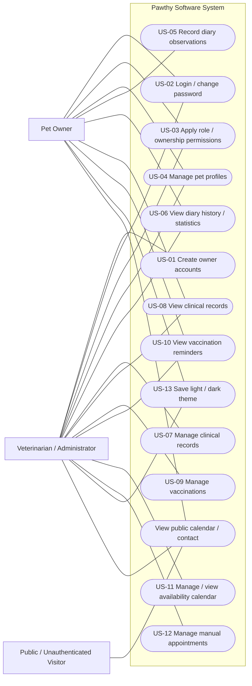
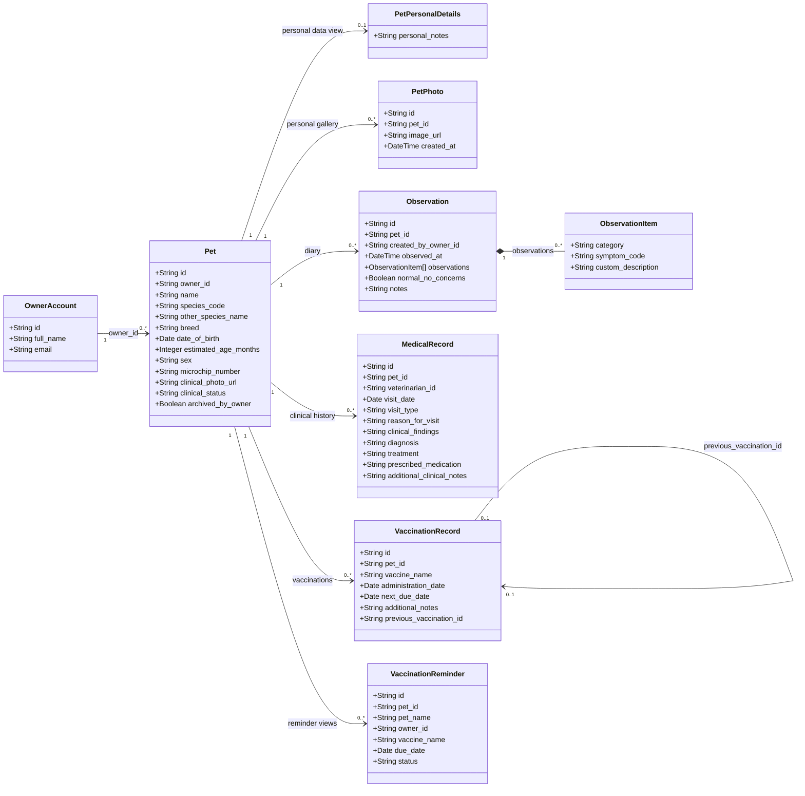
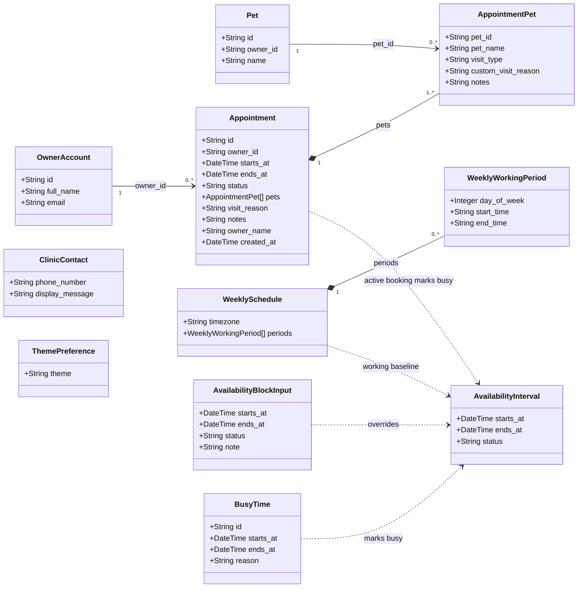
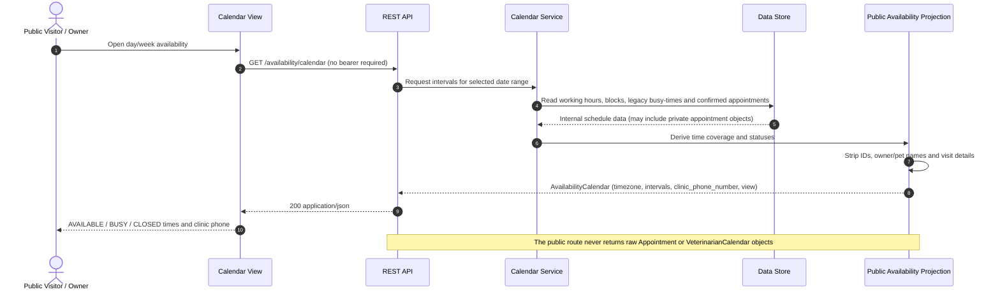
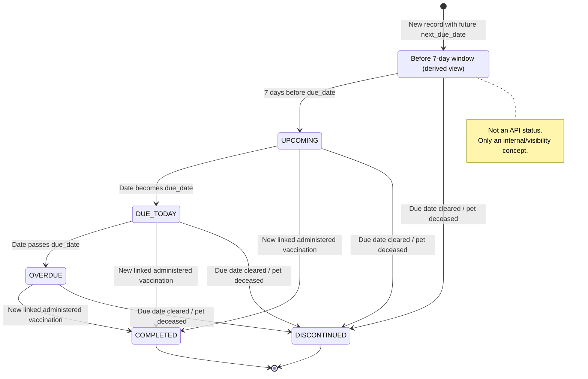

# Pawthy — UML Design Diagrams (Sprint 2)

> **Owner:** Efe, Software Architect · **Date:** 2026-11-19 · **Status:** PROPOSED, not implemented  
> **Contract:** `api/openapi.yaml` OpenAPI v0.6.3 (`develop` HEAD `a5c08a8534c8e6512f6621628bf751b434977d83`)  
> **Requirements:** Sprint 1 final-working report, **US-01–US-13**. Formal Sprint 2 SRS review remains pending.

## 1. Diagram index and interpretation

| Diagram | Purpose | Related stories / API |
|---|---|---|
| UML Use Case | Functional system boundary covering all **13** user stories | US-01–US-13, role permissions |
| UML Class A | Owner, pet, diary, clinical/vaccine and reminder data schema | `/pet-owners`, `/pets`, `/observations`, `/medical-records`, `/vaccinations` |
| UML Class B | Scheduling, appointments, intervals, clinic contact and theme | `/appointments`, `/availability/*`, `/veterinarian/*`, `/clinic/contact`, `/me/theme` |
| Sequence 1 | Vet-provisioned credentials and mandatory first-login password replacement | US-01–03 · `/auth/login`, `/auth/change-password` |
| Sequence 2 | Conflict-controlled **manual** appointment entry | US-11–12 · `POST /appointments`, public calendar |
| Sequence 3 | Vaccination entry, 7-day reminder and linked replacement | US-09–10 · vaccinations and reminders |
| Sequence 4 | Public calendar privacy projection | US-11–12 · `GET /availability/calendar` |
| State 1 | Appointment lifecycle | `CONFIRMED`, `CANCELLED` |
| State 2 | Vaccination reminder lifecycle | `UPCOMING`, `DUE_TODAY`, `OVERDUE`, `COMPLETED`, `DISCONTINUED` |

**Notation:** Class attributes use the **exact JSON field names** from OpenAPI. An association or container is a **logical proposed relationship**, not a claim about SQL foreign-key implementation. `DateTime` implies ISO 8601 offset-bearing strings where the API contract requires them. **Optional** attributes are explicitly stated in the notes below. Mermaid renders Class/Sequence/State diagrams on GitHub; the use-case overview is also supplied as a conventional PlantUML file, [`use-cases.puml`](use-cases.puml).

## 2. Use Case Diagram — All 13 Stories

This Mermaid view is a **use-case-style system boundary**, not a strict UML use-case notation. The accompanying `.puml` is the formal UML use-case representation. `PUBLIC` endpoints are available without login; they do not create an additional authenticated user type.



**Role-precision notes:** US-04 is deliberately shared at the *story* level, but actions are distinct: vet creates/edits **clinical identity** and uploads clinical photo; owner manages **personal notes/photo gallery** and archive visibility. US-11 is also mixed: vet edits schedule and blocks; owners and public visitors only **read privacy-safe times**. US-12 is veterinarian-only; owner appointment access is **read-only** and appointment arrangements happen offline. US-03 is a cross-cutting server authorization rule, not a page that users can invoke to change permissions.

## 3. Class Diagram A — Pet Health and Clinical Data



### 3.1 Field and lifecycle constraints

- The classes above mirror **OpenAPI response schemas**, not necessarily DB tables. `OwnerAccount` represents a pet-owner record; the vet's login identity/credential storage model is **not specified** by those schemas and is deliberately not fabricated here.
- The **required** OpenAPI fields are: `OwnerAccount(id, full_name, email)`; `Pet(id, owner_id, name, species_code, sex, clinical_status, archived_by_owner)`; `Observation(id, pet_id, created_by_owner_id, observed_at)`; `MedicalRecord(id, pet_id, veterinarian_id, visit_date, visit_type)`; `VaccinationRecord(id, pet_id, vaccine_name, administration_date)`; `VaccinationReminder(id, pet_id, vaccine_name, due_date, status)`. Other displayed attributes may be optional (or conditionally present) as specified by schema.
- `Pet.sex` is `FEMALE | MALE | UNKNOWN`; `Pet.clinical_status` is `ACTIVE | DECEASED | NO_LONGER_AT_CLINIC`. Archiving an owner view must not delete clinical history; `DECEASED` discontinues future reminders.
- `Observation.observations` contains zero or more `ObservationItem` values with `category`, `symptom_code`, and optional `custom_description`. Input must have observation content or written notes according to Sprint 1. Owner can edit/delete their own entries, vet only reads. **No entry on a date does not mean healthy.**
- `MedicalRecord.visit_date` and `visit_type` are required, unlike optional findings, diagnosis and notes. An absent diagnosis must not be interpreted as “normal.”
- `VaccinationRecord.next_due_date` may be **null**, and `previous_vaccination_id` links a new vaccination to an older one. The `VaccinationReminder` is an API view/derived lifecycle based on recorded due dates; whether it is stored as its own SQL table is **not decided**.
- **Access-control is not visible in class multiplicities**: every operation still requires server-side role and owner/pet checks, including access to media URLs.

## 4. Class Diagram B — Scheduling, Calendar and Preferences



**Exact schema nuance:** The API defines `AvailabilityBlockInput` fields above, but its `AvailabilityBlock` response schema currently uses an `allOf` composition; it is not a separately specified database entity. Using `AvailabilityBlockInput` prevents inventing additional columns. `WeeklySchedule`, `ClinicContact` and `ThemePreference` are contract representations; persistence ownership/detail may change. `AppointmentPetInput` (creation) requires `pet_id`, while `AppointmentPet` (response) also requires `visit_type`.

**Status/validation rules:** `Appointment.status = CONFIRMED | CANCELLED`; `AvailabilityBlockInput.status = AVAILABLE | BUSY`; `AvailabilityInterval.status = AVAILABLE | BUSY | CLOSED`; `ThemePreference.theme = LIGHT | DARK`. A valid appointment has an end after its start, lasts **at least 10 minutes**, falls inside allowed clinic time and does not overlap another active booking or busy period. `CANCELLED` is retained as history but freed from the busy projection. Owners cannot create/update/cancel appointments via web UI. Public availability is a **separate aggregate result**, not `Appointment` objects with fields merely hidden by CSS.

## 5. Sequence Diagram 1 — First Login & Mandatory Password Change (US-01, US-02, US-03)

```mermaid
sequenceDiagram
    autonumber
    actor Vet as Veterinarian
    actor Owner as Pet Owner
    participant UI as Web UI (HTML/JS)
    participant API as REST API
    participant Auth as Auth/Access Module
    participant DB as Data Store
    Vet->>UI: Create owner account during clinic visit
    UI->>API: POST /pet-owners (vet bearer)
    API->>Auth: Require role VETERINARIAN
    Auth-->>API: Authorized
    API->>DB: Create owner + secure temporary credentials
    DB-->>API: Created owner
    API-->>UI: 201 OwnerProvisioned (temporary_password shown once)
    Note over Vet,Owner: Vet gives temporary password in person (outside system)
    Owner->>UI: Enter email + temporary password
    UI->>API: POST /auth/login (public)
    API->>Auth: Validate credentials
    Auth->>DB: Verify credential state
    DB-->>Auth: Valid; password change required
    Auth-->>API: LoginResult
    API-->>UI: 200 {access_token, must_change_password: true, ...}
    UI-->>Owner: Show mandatory change-password screen
    Owner->>UI: Submit old + new password
    UI->>API: POST /auth/change-password (bearer)
    API->>Auth: Validate old/new; apply credential change
    alt Valid new password
        Auth->>DB: Save secure replacement; invalidate prior tokens
        DB-->>Auth: Updated
        Auth-->>API: Change accepted
        API-->>UI: 204 No Content
        UI-->>Owner: Enter normal authorized portal
    else Wrong old / unchanged new password
        Auth-->>API: Validation rejected
        API-->>UI: 422 application/problem+json
        UI-->>Owner: Correct password entry
    end
    Note over API,Auth: Missing/invalid bearer on protected endpoints: 401; wrong role: 403
```

**Checks to cite:** `POST /pet-owners` vet-only (`201`); `POST /auth/login` public (`200`, invalid credentials `401`, rate-limit `429`); `POST /auth/change-password` (`204`, validation `422`). The API states password replacement invalidates tokens issued before change. Password hashing/token revocation implementation is not specified by OpenAPI.

## 6. Sequence Diagram 2 — Conflict-Controlled Manual Appointment (US-11, US-12)

```mermaid
sequenceDiagram
    autonumber
    actor Owner as Pet Owner
    actor Vet as Veterinarian
    participant UI as Vet Calendar UI
    participant API as REST API
    participant RBAC as Authorization
    participant Cal as Calendar/Appointment Service
    participant DB as Data Store
    Owner->>Vet: Request appointment by telephone / in person
    Note over Owner,Vet: No online booking API or approval queue
    Vet->>UI: Select owner, pet(s), start/end time
    UI->>API: POST /appointments (vet bearer; owner_id, pets, starts_at, ends_at)
    API->>RBAC: Require VETERINARIAN and valid owner-pet linkage
    alt Missing token or wrong role
        RBAC-->>API: Reject (401 / 403)
        API-->>UI: Authorization error
    else Role and objects permitted
        RBAC-->>API: Authorized
        API->>Cal: Check end > start; duration >= 10 min
        Cal->>Cal: Check weekly hours, blocks, busy-times and overlaps
        alt Bad interval or outside permitted schedule
            Cal-->>API: Validation rejection
            API-->>UI: Documented validation error (422 when applicable)
        else Conflicting active appointment
            Cal-->>API: Conflict
            API-->>UI: 409 Conflict
        else Valid free interval
            Note over Cal,DB: Proposed atomic write + concurrent conflict safeguard (not implemented yet)
            Cal->>DB: Verify free slot and persist CONFIRMED appointment atomically
            alt Concurrent transaction takes slot first
                DB-->>Cal: Conflict / cannot confirm
                Cal-->>API: Conflict
                API-->>UI: 409 Conflict
            else Booking recorded
                DB-->>Cal: Saved appointment
                Cal-->>API: Appointment (CONFIRMED)
                API-->>UI: 201 Created
                UI-->>Vet: Show booked interval in private calendar
            end
        end
    end
    Note over API,Cal: Public GET /availability/calendar shows BUSY time, not owner/pet/visit details
```

**Nuance:** The validation code for every out-of-hours/busy-time case is **not universally pinned** by all response descriptions; use `409` for the documented appointment conflict and do not invent a precise error code for unqualified behavioral rejections. Cancellation is a `PATCH /appointments/{appointmentId}` with `status: CANCELLED`; it remains in history but frees the interval.

## 7. Sequence Diagram 3 — Vaccination and In-App Reminder (US-09, US-10)

```mermaid
sequenceDiagram
    autonumber
    actor Vet as Veterinarian
    actor Owner as Pet Owner
    participant UI as Web UI
    participant API as REST API
    participant Vacc as Vaccination/Reminder Module
    participant DB as Data Store
    Vet->>UI: Enter administered vaccine and optional next_due_date
    UI->>API: POST /pets/{petId}/vaccinations (vet bearer)
    API->>Vacc: Validate vet role, authorized pet, required fields
    Vacc->>DB: Persist VaccinationRecord
    DB-->>Vacc: Created vaccination
    Vacc-->>API: VaccinationRecord
    API-->>UI: 201 Created
    Note over Vacc,DB: Reminder is computed from vet-entered next_due_date (storage strategy TBD)
    Owner->>UI: Open vaccination reminders
    UI->>API: GET /vaccination-reminders (owner bearer)
    API->>Vacc: Restrict to owner's pets and determine due-date status
    Vacc->>DB: Read eligible pet + vaccine records
    DB-->>Vacc: Authorized vaccine data
    Vacc-->>API: Active reminders (UPCOMING / DUE_TODAY / OVERDUE)
    API-->>UI: 200 ReminderList
    UI-->>Owner: Display website-only reminder
    opt Vet records a subsequent linked vaccination
        Vet->>UI: Link new vaccination to previous_vaccination_id
        UI->>API: POST /pets/{petId}/vaccinations
        API->>Vacc: Validate linkage and update reminder lifecycle
        Vacc->>DB: Persist linked vaccination
        DB-->>Vacc: Saved
        Vacc-->>API: New record; previous reminder becomes COMPLETED
        API-->>UI: 201 Created
    end
    opt Vet clears next_due_date or pet is marked deceased
        Vet->>UI: Update vaccine/pet record
        UI->>API: PATCH appropriate veterinarian-only endpoint
        API->>Vacc: Recalculate reminder lifecycle
        Vacc-->>API: Previous active reminder is DISCONTINUED
        API-->>UI: 200 Updated resource
    end
    Note over Owner,UI: No external SMS, email or push service
```

**Status meaning:** `UPCOMING` from 7 days before vet-entered due date, `DUE_TODAY` on the date, `OVERDUE` after; `COMPLETED` after a linked administered vaccination and `DISCONTINUED` for a cleared next due date or deceased pet. These status names come from OpenAPI; the calculation/storage mechanism is a proposed design. The default endpoint returns only active reminders; completed/discontinued results require an explicit status filter.

## 8. Sequence Diagram 4 — Privacy-Safe Public Calendar (US-11, NFR-02)



**Why the fourth scenario?** Public calendar privacy is one of the project's highest-risk architectural boundaries. This extra diagram remains within **architecture/UML** ownership; it does not write QA tests or frontend screens for another teammate.

## 9. State Machine A — Appointment Lifecycle

```mermaid
stateDiagram-v2
    [*] --> CONFIRMED : Vet creates valid manual appointment / POST 201
    CONFIRMED --> CONFIRMED : Vet edits or reschedules; revalidate time & conflicts
    CONFIRMED --> CANCELLED : Vet cancels / PATCH status=CANCELLED
    CANCELLED --> [*] : Remains archived in history; not BUSY
    note right of CONFIRMED
       Appointment occupies calendar time.
       Only veterinarian may create/edit.
    end note
    note right of CANCELLED
       No time held; historical record retained.
       Reconfirmation is not specified by contract.
    end note
```



**Exact enum:** `Appointment.status ∈ {CONFIRMED, CANCELLED}`. There is no `PENDING_APPROVAL`, `REJECTED` or owner online booking state. The `[ * ]` start/end markers are **UML pseudostates**, not extra API statuses. Transition from `CANCELLED` to `CONFIRMED` is deliberately **not** modeled because its behavior is not clearly guaranteed by the published contract.

## 10. State Machine B — Vaccination Reminder Lifecycle



**Exact OpenAPI status enum:** `UPCOMING | DUE_TODAY | OVERDUE | COMPLETED | DISCONTINUED`. `NotVisible` is a **diagram-only lifecycle phase** before the 7-day display window, not a field value returned by the API. Changing a due date can recalculate the derived state; no automated scheduler, specific cron process or persisted reminder table has been confirmed. Status history and edge-case policy need technical review.

## 11. UML-to-API design consistency summary

| Rule | UML coverage | Evidence and limitations |
|---|---|---|
| No owner online booking | Use Case, Manual Appointment sequence, Appointment state | Only veterinarian may `POST /appointments` and `PATCH /appointments/{appointmentId}`; offline contact is external |
| First-password replacement | Sequence 1 | `must_change_password`, `POST /auth/change-password 204`; token lifecycle contract, not implementation |
| Ownership / RBAC | Use Case, Class A, Sequences 1–3 | API `x-roles`; private cross-owner objects `404`; verify runtime later |
| Owner diary, vet read-only | Class A, Use Case | `/observations` owner writes, vet reads; missing day not healthy |
| Clinical record ownership | Class A, Use Case | Vet writes `/medical-records`; owner reads |
| Reminder state semantics | Sequence 3, State B | Due date from vet, no diagnosis, no external notifications |
| Calendar privacy | Sequence 4, Class B, Use Case | `AvailabilityCalendar` is a separate public response, not a raw `Appointment` |
| Interval and concurrency | Sequence 2, State A | 10-minute minimum; proposed atomicity, **no executed test** |
| Theme and clinic phone | Class B, Use Case | `ThemePreference`, `ClinicContact`, public contact response |

## 12. Peer-review checklist

- [x] All **13** current user stories represented by the use-case overview.
- [x] Classes use exact current OpenAPI response/request fields and distinguish response models from persistence decisions.
- [x] Three specifically requested sequence flows covered; fourth privacy flow added within architect scope.
- [x] Appointment and reminder state machines use exact contract statuses; noncontract states explicitly labeled conceptual.
- [x] No owner online booking, approval queue, React requirement, external SMS/email, billing or automatic diagnosis.
- [ ] Verify forthcoming Deniz Sprint 2 SRS against actors, actions, classes and states.
- [ ] Resolve outstanding backend framework and busy-time precedence decisions with technical team.
- [ ] Request peer review, link the architect's Issue/PR and record review decisions.

**Related documents:** [`../architecture/c4-architecture.md`](../architecture/c4-architecture.md) · [`../architecture/api-srs-alignment.md`](../architecture/api-srs-alignment.md).  
**Source honesty:** These diagrams are **design artifacts**. No implementation, database migration or API test has been verified by the diagrams themselves.
